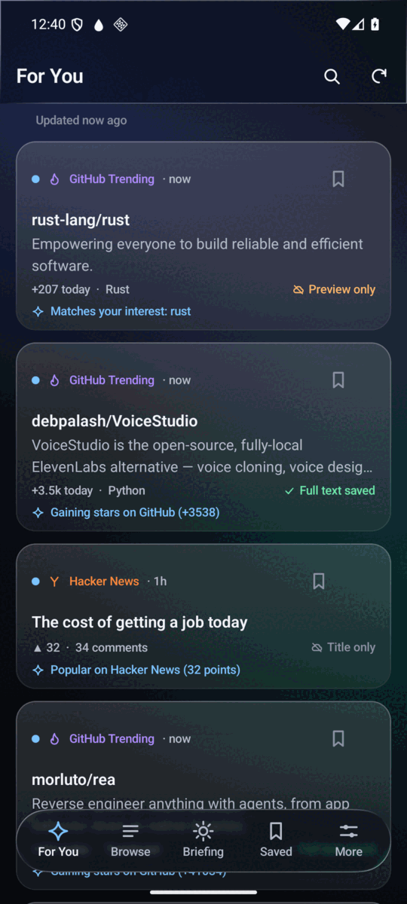
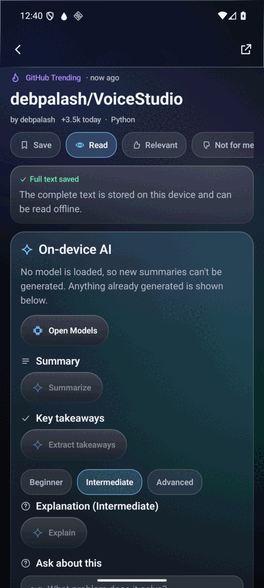
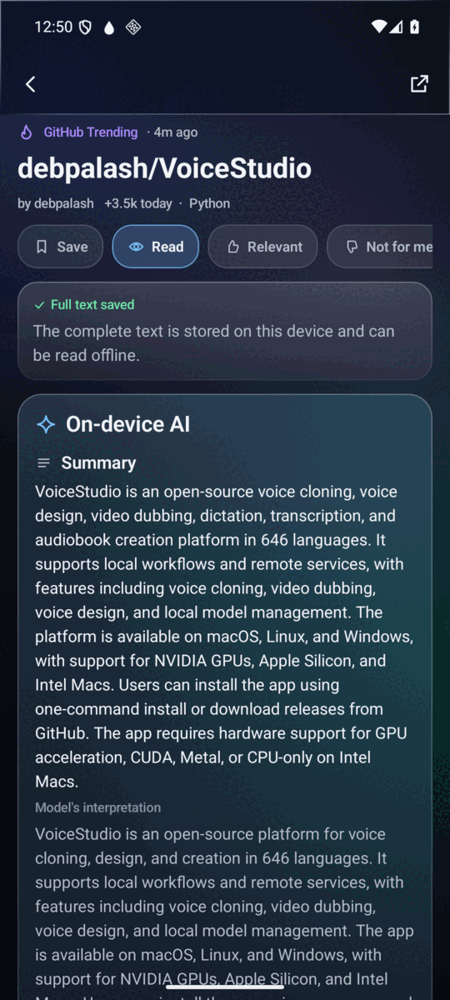
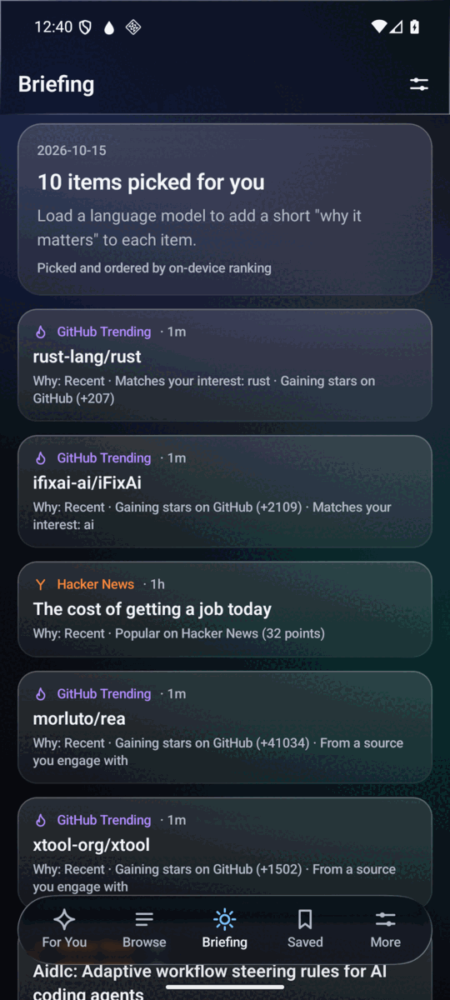

# ByteBrief

**A privacy-first tech reader whose AI runs on your phone.**

ByteBrief collects what is worth reading from Hacker News, GitHub Trending, GitHub Releases and your own RSS/Atom
feeds, then uses a language model **running locally on the device** to summarize articles, explain projects,
extract key points, answer questions about an item, and write a personalized daily briefing.
No account, no analytics, no cloud inference.

<p align="center">
  
  
  
  
</p>

> Screenshots come from the Android 16 emulator. The glass bars and tab bar are the real
> [Liquid Glass](https://github.com/Kyant0/AndroidLiquidGlass) effect refracting the content scrolling beneath them.

## Features

| Area | What you get |
|---|---|
| **Sources** | Hacker News (top / new / best / Show / Ask, official API) · GitHub Trending (HTML adapter + REST enrichment) · GitHub Releases for repositories you follow · RSS 2.0 / RSS 1.0 / Atom feeds with OPML import and export and feed auto-discovery · XDA Forums (follow device forums, read whole threads offline, new-thread alerts; the site's human check runs in a WebView and can be completed by hand) |
| **Local AI** | Summary · key takeaways · explanation at three levels · grounded Q&A (with a check that the quoted evidence really is in the text) · daily briefing. Output is forced into valid JSON by a grammar, then validated |
| **Offline** | Everything you have collected is stored in Room. Full article text is saved on request or when you bookmark. Each item says plainly whether you have the **full text, a preview, or just the title** |
| **Search** | Full-text search (SQLite FTS4) with filters for source, topic, language, date, read state and bookmarks |
| **Ranking** | Transparent and local: recency, source-reported popularity, your interests, corroboration across sources, diversity. Every item can say *why* it was picked. Total GitHub stars are never used as a quality signal. You can disable learning and reset it |
| **Deduplication** | The same subject posted on Hacker News, trending on GitHub and covered by a blog is grouped, with links to each source |
| **Background** | WorkManager periodic sync with constraints and exponential backoff · scheduled daily briefing notification · optional release alerts |
| **Design** | Dark Liquid Glass UI with an opaque fallback (setting, battery saver, reduced motion), adaptive two-pane layout on wide screens, 48 dp targets, labelled controls |

## Requirements

* Android **13 (API 33)** or newer. Built and tested for Android 16 (API 36).
* arm64-v8a devices (all current phones). An x86_64 build exists for emulators.
* A language model is optional but needed for AI features: 1.07 GB (light) or 2.38 GB (default). It is downloaded
  only when you ask, over Wi-Fi unless you explicitly confirm mobile data.

## Install

Signed APKs are attached to each [GitHub release](https://github.com/LinuxKernel44/ByteBrief/releases).
Use `app-arm64-v8a-release.apk` on a phone. Verify the download against the published `SHA256SUMS` file.

## Build from source

```bash
git clone --recurse-submodules https://github.com/LinuxKernel44/ByteBrief.git
cd ByteBrief
./gradlew :app:assembleDebug          # debug APK, no signing needed
./gradlew :app:testDebugUnitTest      # JVM tests
./gradlew :app:lintRelease            # Android Lint (fails the build on errors)
```

Prerequisites: JDK 17 or newer, Android SDK platform 37, build-tools 36, NDK **29.0.13113456**, CMake **3.31.6**
(all installable with `sdkmanager`). llama.cpp is a pinned git submodule (`third_party/llama.cpp`, tag `b11642`).

A release build is signed with a key you provide through `keystore.properties` (git-ignored) or the
`BYTEBRIEF_*` environment variables; without them `assembleRelease` produces an unsigned APK.

## Tests

* **207 JVM unit tests** (all passing) covering URL canonicalization, parsers, sources against a mock server, ranking, the AI
  pipeline (against a scripted generator), prompt sanitizing, downloader resume and tamper handling, scheduling
  across daylight-saving changes, and Markdown rendering rules.
* **71 instrumented tests** (all passing) on an Android 16 emulator — 6 JNI tests in `:llama` and 65 in `:app`, 17 of them
  running a real model: Room (including FTS), end-to-end sync across all four sources, AI
  caching and invalidation, the briefing service, Keystore token storage, the daily-briefing worker (a real
  notification is posted) and UI smoke tests that drive the real glass renderer. The model tests use the real
  Qwen3-4B (grounded Q&A, prompt-injection resistance, cancellation, briefing validation).

See [docs/TESTING.md](docs/TESTING.md) for how to run each suite and what each one proves.

## Privacy and security in one page

* The only network traffic is to the sources you enable (Hacker News, GitHub, your feeds, article pages when you
  save text, article thumbnails if enabled) and, if you ask, the model download from Hugging Face.
* XDA Forums are read through the system WebView, public pages only. ByteBrief never signs in; the site's cookies stay in
  the WebView store and are cleared when you stop following the last forum.
* Prompts, summaries, questions and your reading history never leave the device.
* All traffic is HTTPS: cleartext is blocked by the network security config, https-to-http redirects are refused,
  `file:`/`content:`/other schemes are never fetched.
* Downloaded models are verified against a pinned SHA-256 before use. A corrupt or truncated file is deleted.
* Article text is untrusted. It is sanitized (chat-control tokens and invisible characters are neutralized), fenced
  between random per-request markers, and the model's output is constrained to a JSON grammar and validated.
  Links are stripped from model output and nothing from an article is ever executed.
* The optional GitHub token is encrypted with an Android Keystore key. Backups are disabled.

## What is verified, and what is not

Verified in this repository:

* The full flow on an **Android 16 x86_64 emulator**, driven through the real UI: first-run, sync from the live
  Hacker News and GitHub services, a 1.07 GB model downloaded with a pause and resume and hash verified,
  loaded, and used to summarize a README. The signed, R8-minified release APK was run through the same flow.
* Real-model behaviour of Qwen3-4B-Instruct-2507 Q4_0 and Qwen2.5-1.5B-Instruct Q4_0 on the emulator.

**Not verified** (be aware before relying on it):

* **No test has run on a physical OnePlus 15 or any arm64 device.** The arm64 native libraries compile, but their
  speed, memory use and thermal behaviour on a Snapdragon 8 Elite Gen 5 are unmeasured. The in-app benchmark
  (More → Language models → Run benchmark) exists so you can measure it yourself.
  The emulator numbers (≈44 tokens/s generation for the 1.5B model) come from a desktop CPU and say nothing
  about a phone.
* Liquid Glass performance on a real GPU is unmeasured (the emulator renders in software). If it is slow on your
  device, turn on *Settings → Use solid surfaces*.
* Accessibility was reviewed from the semantics tree and screenshots, not with TalkBack or a user study.
* GitHub Trending is read from a web page that has no official API. If GitHub changes its markup, the source
  reports an error instead of returning nothing silently, and the adapter in
  `source/github/TrendingParser.java` is the only place that needs updating.
* Small models make mistakes. ByteBrief validates structure, checks quoted evidence and strips links, but cannot
  guarantee factual accuracy. Read the original for anything important.
* llama.cpp runs on the CPU. GPU/NPU backends (OpenCL, Hexagon) are not enabled.

## Project layout

```
app/                  Android application (Java logic, Kotlin Compose UI shell)
  src/main/java/      data, sources, AI pipeline, ranking, repositories, workers, ViewModels
  src/main/kotlin/    Compose UI only: theme, glass kit, components, screens
llama/                JNI module over llama.cpp (C++ bridge + Java API)
third_party/llama.cpp pinned submodule
docs/                 architecture, testing, models, dependencies
```

Why some Kotlin? The Liquid Glass library exposes a Compose-only API (`Modifier.drawBackdrop`), which cannot be
called from Java. Kotlin is therefore limited to the UI shell (about a quarter of the code); everything else —
networking, persistence, AI, ranking, background work and all ViewModels — is Java. Details in
[docs/DEPENDENCIES.md](docs/DEPENDENCIES.md) and [docs/ARCHITECTURE.md](docs/ARCHITECTURE.md).

## License

Apache License 2.0 — see [LICENSE](LICENSE) and [NOTICE](NOTICE). Language models are downloaded from their
publishers and keep their own licenses (both bundled choices are Apache-2.0).
